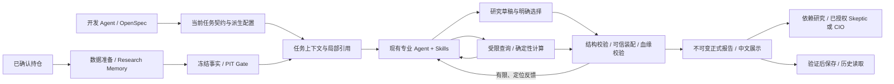

# 总体问题分析与处理归属

检查日期：2026-09-29。范围为当前工作区与已存在的八维运行产物；本轮没有运行测试、产品 LLM 或 Gate，没有修改实现。源码处于脏工作区，HEAD `eefc90ab2f827b469861bb5fb3af8c5192ac8211` 不代表全部当前实现。以下区分实际文件核对、历史验收记录及设计风险；不把所有潜在接缝都称为已发生故障。

## 1. 结论：不是没有研究能力，而是三类问题互相放大

1. **交接职责仍不一致。** 部分入口已由程序绑定身份、传短引用、装配文档；其他位置仍让 LLM 重写计算字段、路径、回执 hash。修复研报提交，并没有同时消除基本面的计算转录负担。
2. **研究内容确实存在错误。** 历史记录显示金额精度、财务期间、引用主体、作者预测与管理层转述、上游主张关系等问题。引用合法和八份报告保存不能证明内容正确；这些问题不能全部归咎于校验过严。
3. **验收单元过大、当前要求与历史尝试混杂。** 一维改动多次触发全部八维重生，修好旧问题又出现别维内容退化。原任务还把不同历史批次的内容失败留作多个未完成项，读起来像每批都必须重新成功；实际上旧失败不能改写，应由最新修复证明关闭缺陷，原最终内容义务单独验收。

解决方向是：降低机械转录错误、缩小调试闭包、冻结验收问题，保留真实研究责任；不是减少 Evidence/PIT/Risk，也不是继续按每个错误词句累加 Python 规则。

## 2. 当前八维进度与最新失败

OpenSpec 当前显示 **92/106** 项；14 个未勾选项为：`8.40、8.17、8.19、8.23、8.26、8.29、8.31、8.35、5.3、5.5、5.6、5.11、6.16、6.11`。其中多个任务同时描述“某历史批次已运行”与“内容尚未通过”，不是14项独立未实现功能。

- 数据接入、同 Gate 准备、八维调度、短引用、研报结构化提交、部分原值绑定等已有实现和记录；本轮未独立重跑其测试。
- 历史验收记录的 v6/v7/v8/v9 均保存8份报告；内容分别有失败，v7/v9记录为7/8、v8为5/8。以上质量评分来源于现有独立复核记录，不是本轮重新逐句评价。
- 最新 v4 关系子句批次（不是历史同名 v4）：本轮实际读取到 **7 Start、7 Stop、6 SAVED、1 FAILED**，基本面失败、依赖研报未启动；没有 process-result、execution-proof 或最终 bundle。
- 累计至少180子/37父是原执行账本口径，本轮仅直接核对最新7次启动，不将全部历史计数冒称重算完成。用户暂停导致最终收尾中断，终态产物缺失不能全部算到计算字段错误头上。

### 最新 FIRST_DIVERGENCE

运行目录（仓库外私有，不提交原包）：

`/Users/caihaoming/Library/Application Support/StockAgent/acceptance-runs/eight-dimension-rebuild-20260928/eight-dimension-v4-acceptance.8iWZu9/run`

基本面原稿的计算对象用了 `result` 和 `evidence_refs`；当前正式计算结构要求 `value` 和 `input_evidence_refs`。真实计算 `mrvl_fy26_close_pe_20260925_01` **存在**，实际 operation 为 `ratio`，对应原任务成功事件与收据。收据自身 canonical hash、事件自身 canonical hash、事件 output_hash 与收据 output 的 hash 均通过本轮只读重算。

当前 `_validate_multidimensional_tool_calculations` 在正式草稿结构校验前执行，条件将“找不到计算ID”和“输入引用列表不等”合并为同一个 `MULTIDIMENSIONAL_CALCULATION_RECORD_MISSING`。此处缺失字段得到 `None`，与真实列表不等，首错因而被误分类；纠错分支又未包含这一代码，记录 `NOT_ALLOWED`。

**ROOT_CAUSE（可观察链路）**：模型重复编写计算对象并输出了不同结构 → 结构校验顺序偏后 → 血缘检查把字段缺失混报为收据缺失 → 未进入原同会话纠正 → 基本面无合法产物 → 研报依赖阻断。不是此次计算未执行，不是此次收据 hash 不一致，也不能据此断言只改两个字段后整份基本面就会通过。原稿还有其它结构差异，实施时须一次完整列出，而不是继续首错逐个重跑模型。

### 本轮核对的完整文件标识

以下均为文件字节 SHA256，非报告内部 `report_hash`；不混用两种 hash 口径。

| 文件（相对上述 run） | SHA256 |
|---|---|
| `invocation/subagent-events.jsonl` | `bd2bde6566fae256e30f1f04b5dcf7622c617bb3bb8f744ffa4777fc983314a3` |
| `events/mcp/events.jsonl` | `1c679709850246d2fc07f369c5215c52797f389fea08bec99a1f468d33019b8f` |
| `research/raw-drafts/e08e27fd5cb0940b49306228f00e1a3ea6384c5ce92cee2ad166283259e1fba0-attempt-1.json` | `19cd87924256985256e10a9c0e600a881ad084b9540f977010a2658245f3445c` |
| `research/calculations/b3f4b3da1e39da42/tool-results.jsonl` | `4c3d1c1eabc11c06a42a2d9695a06e2080b031a4348a479738e17aa0c53c7028` |
| `evidence/gate.json` | `35f8f89c7bc1405e9b8a7f3e6ed23e49272fdbed85669ad785ca72ea390cd0ba` |
| `audit/portfolio-handoff.json` | `42a586449b99c07c67756d59c8e65bafcaef3eaa3bda0c5f3e0708f856287a5b` |

关键当前源码文件字节标识（不是完整生产版本锁）：

| 文件 | SHA256 |
|---|---|
| `product/runtime/codex_hook_recorder.py` | `195df8113de9f8f59df5aabdf786db5e0ba14037a42c81b967b86cd3bfa6c5bd` |
| `product/runtime/research_submission.py` | `07f9c275697cc074d5d968c3cfb7416cc78c2ac0bc034c150f3a5f63d99ba691` |
| `product/runtime/multidimensional_stage.py` | `ce95ec9fd74dc807945b46a84531994bc80cd74bb11d7870bf43818d7ecc7686` |
| `product/runtime/multidimensional_references.py` | `48c903e648f6dd0ab5c29fb8c9a62dae5bbd733b618ec83266650127481d70f7` |
| `product/runtime/schema_validation.py` | `ea484136bf3ae8eec2a8ff33b4ffb5bdde3f5f5fd2198c5ca06f56969fd6503d` |

本轮取证方法：读取原始 JSONL、原稿、收据，按现有 canonical 序列化独立重算事件/收据 hash，并逐行对照校验顺序与错误分支；未调用运行 finalizer 写入旧包，也没有自动修订原稿。

## 3. 全景：生产者、消费者与职责

八维阶段当前只需生成可消费研究报告；图中下游不构成本次启动授权。资料准备及存储不是新增 Agent，短引用不是新的事实ID，历史研究判断不是原始事实。

## 4. 与此前19类问题的合并处置

“本次”是明确实施范围；“后续”只登记方案，不作为本次完成门槛。已存在机制复用，不再从零造一遍。

| # | 接缝及证据性质 | 处理方法与归属 |
|---|---|---|
| 1 | 身份/派发抄写；可信 Start 绑定已有 | 本次：八维草稿不再要求身份，矛盾身份拒绝，服务端绑定；不把 bearer token 冒称会话认证 |
| 2 | Evidence 短引用只在部分链路启用 | 本次：八维模型视图统一；后续：普通股/Skeptic/CIO 按实际入口迁移 |
| 3 | 依赖 Claim 用裸ID，跨报告重名风险 | 本次：解析到报告版本+claim，歧义拒绝；不做模糊对应，保持旧报告读取 |
| 4 | 文档元数据重复抄写；研报已有选择装配 | 本次：八维复用选择装配，LLM仍负责选对文档及出处 |
| 5 | 计算ID/输入/结果/路径重抄；最新已发生 | 本次最高优先：计算选择装配，区分结构错误、未知计算、输入漂移与事件损坏 |
| 6 | 资料准备重复记录查询/产物路径 | 后续：审计来自实际工具事件，LLM仅解释选择；当前不重做数据准备 |
| 7 | 提交回执仍要求抄完整 hash | 本次：任务内短提交引用精确绑定不可变版本；服务端校验完整 hash，不能改成“随便取最后一稿” |
| 8 | 研报v4提交与其它维长JSON文本双轨 | 本次：八维新写入统一对象提交；旧包明确兼容，不宣称已具备完全受限解码 |
| 9 | CIO仍复制已消费报告hash | 后续：由实际授予与读取记录装配，模型只选报告/主张；本次不启动CIO |
| 10 | common-stock Eval仍要求input/result hash | 后续：沿已有native draft做评分元数据装配；不自动启动评分/晋升 |
| 11 | 全报告重写引入其它段落退化 | 本次：同任务一次局部修订与完整再验证，语义修订仍由LLM完成 |
| 12 | 版本多处声明漂移；CIO3.1.2/3.1.0仍存在 | 本次：仅当前八维版本权威及派生一致；CIO先登记为旧路径问题，不盲改版本号凑齐 |
| 13 | 文件hash/对象hash/排除自身字段混用风险 | 本次：新提交与映射明确hash口径、单一装配；后续：不全库替换历史hash算法 |
| 14 | Memory事实与Gate视图附加字段曾漂移 | 保留已有 `view_compatible_fact_hash` 方案；本次兼容验证，后续才调整持久化身份 |
| 15 | 通用Schema子集缺组合关键字，专用校验另补 | 本次：新草稿实际使用关键字必须完整生效，不支持拒绝；旧NO_TRADE专用校验保留，不能声称已发现Risk绕过 |
| 16 | 历史包读取依赖当前仓库/原目录风险 | 本次保证未改旧包和八维消费者兼容；后续专门梳理历史读取，不扩Replay Executor |
| 17 | topology/routes/消费审计多套映射 | 本次检查八维交接不丢既有数据；全来源映射合并后续处理，不新增provider |
| 18 | 进程、报告合法、内容充分性混为PASS | 本次：输出分层结果，失败维不被父退出0覆盖；真实语义仍独立核对 |
| 19 | 当前要求、固定样本和历史诊断层层堆叠 | 本次：整理生效契约/方法/实例职责，历史留档索引；CIO固定MRVL等其它模式后续按范围处理 |

## 5. 为什么“一天也没结束”

- 当前 Proposal/Design/Tasks 加验收记录约 **536,042 UTF-8 字节、1,975行**，不含四份 delta spec。许多内容是在多个规划文件复述同一批失败、预算及下一次入场，增加开发上下文开销和理解旧额度的风险；这不是产品LLM token的实测值。
- 最新定点入口首次闭包限于基本面→研报；期权等任务虽独立，仍常被迫整批补验。八个随机生成任务一次全部达标，比单个已定位缺陷关闭更容易受到无关内容退化影响。这是结构性放大因素，不给出未经统计的概率。
- 多轮内容失败本身真实且重要：来源主体/期间/原单位、合法但无关的上游引用、已查询却未解释Greeks。不能删掉这些标准，也不能说再加一条提示就保证成功。
- 窄金额/正文规则曾被反例证明会误拦假设、否定与错误示例，后撤销；说明程序不适合替模型判断自由文本投资关系。原值选择装配和关系子句是更合理的方向，但不等于内容质量自动通过。
- “几百项确定性测试通过”只证明所测路径；最新真实草稿仍绕过应先发生的结构诊断。需要来自实际失败结构的生产者→提交→消费者测试，而不是再增加同义Prompt字符串断言。

## 6. 收敛办法与不做事项

先关机械交接，再在原宿主定点验证实际受影响任务，最后按原规格做一次干净整批验收。未受影响的来源获取及兼容证据可复用，但不能包装成新同批8/8。确定性层不做“作者观点归属”“引用是否支持主张”的自动裁决；统一最低问题与内容复核表，并区分实质错误和措辞改善建议。

本次规划不宣告八维完成，不继承旧模型额度，不再叠新Agent/平台。若有限真实验证后仍有研究错误，准确停在该内容缺口，给出是否需要方法、模型或验收流程调整的选择，禁止自动无限续跑。若将来希望以逐维可复用证据集合替代同批8/8，必须另行明确批准规格调整；本需求当前没有做这项降范围决定。
